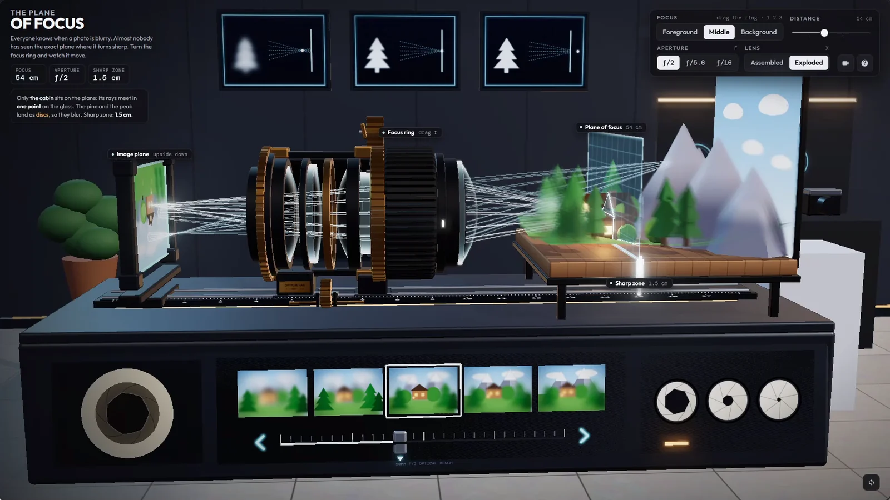

# Waggles

Interactive browser demos by [thtbee_](https://x.com/thtbee_) on 𝕏

**[thtbee.github.io/waggles](https://thtbee.github.io/waggles/)**

---

## About

Waggles is an ongoing collection of standalone browser experiments: 3D scenes, simulations, interfaces and anything else worth playing with.

Each demo lives in its own folder with its own code and README, so any one of them can be read, run or reused on its own. The gallery at the root links them together.

---

## Demos

### 001 · Bee's Waggle

<a href="https://thtbee.github.io/waggles/bees-waggle/"></a>

> ⭐ [Featured by Google on 𝕏](https://x.com/Google/status/2110114445628162512) in their Complex 3D Visualizations showcase.

The daily life of a bee, rendered as an animated radiograph. Five scenes follow a forager from the first specimen shot through the meadow, into the nectar, back to the hive for the waggle dance, and out into the swarm. Seven film stocks change the whole look, from silver-halide X-ray to cyanotype and risograph.

| | |
| --- | --- |
| **Play** | [thtbee.github.io/waggles/bees-waggle](https://thtbee.github.io/waggles/bees-waggle/) |
| **Folder** | [`bees-waggle/`](bees-waggle/) |
| **Built with** | Three.js, WebGL, one HTML file |

### 002 · STRIX HX-9

<a href="https://thtbee.github.io/waggles/strix-hx9/"></a>

A real-time 3D concept gunship. Launch it, fly it and fire its cannon, rockets and missiles, then switch to x-ray, power-flow, airflow or exploded views to see how it is put together. Six environments, from an arctic fjord under the aurora to a rain-soaked neon city.

| | |
| --- | --- |
| **Play** | [thtbee.github.io/waggles/strix-hx9](https://thtbee.github.io/waggles/strix-hx9/) |
| **Folder** | [`strix-hx9/`](strix-hx9/) |
| **Built with** | Three.js, WebGL, Web Audio |

### 003 · Kestrel K-1

<a href="https://thtbee.github.io/waggles/kestrel-k1/"></a>

A full humanoid robot built to be mechanically true: every joint, tendon, cable and actuator is real geometry driven by one physical state, so the whole machine moves in exact coordination. Pose it, set it walking, switch between body and hand, and inspect it in glass, exploded, power, signal, thermal, section and drawing views.

| | |
| --- | --- |
| **Play** | [thtbee.github.io/waggles/kestrel-k1](https://thtbee.github.io/waggles/kestrel-k1/) |
| **Folder** | [`kestrel-k1/`](kestrel-k1/) |
| **Built with** | Three.js, TypeScript, Vite, Blender |

### 004 · Skyward Pagoda

<a href="https://thtbee.github.io/waggles/skyward-pagoda/"></a>

天空の塔. A floating voxel sanctuary crowned by a vermilion pagoda, with terraced waterfalls, sakura groves, mirror lakes, suspension bridges and glowing root caverns above a sea of clouds. Glide between landmarks, wander freely, and watch it move from dawn to night.

| | |
| --- | --- |
| **Play** | [thtbee.github.io/waggles/skyward-pagoda](https://thtbee.github.io/waggles/skyward-pagoda/) |
| **Folder** | [`skyward-pagoda/`](skyward-pagoda/) |
| **Built with** | Three.js, TypeScript, Vite |

### 005 · The Plane of Focus

<a href="https://thtbee.github.io/waggles/plane-of-focus/"></a>

An interactive 3D lens lab that explains camera focus. A 50 mm ƒ/2 lens sits on an optical bench: turn the focus ring, switch aperture, and watch light rays, the plane of focus and the depth of field respond, with real thin-lens numbers on screen. Explode the lens to see its elements.

Recreation of [@RyanSael](https://x.com/RyanSael)'s lens demo.

| | |
| --- | --- |
| **Play** | [thtbee.github.io/waggles/plane-of-focus](https://thtbee.github.io/waggles/plane-of-focus/) |
| **Folder** | [`plane-of-focus/`](plane-of-focus/) |
| **Built with** | Three.js, ES modules, no build step |

---

## Behind the demos

The full workflow and every prompt used to make each demo will be shared here soon.

---

## Layout

```
waggles/
├── index.html        Gallery page
├── assets/           Gallery styles, icon and demo previews
├── bees-waggle/      Demo 001
├── strix-hx9/        Demo 002
├── kestrel-k1/       Demo 003
├── skyward-pagoda/   Demo 004
├── plane-of-focus/   Demo 005
└── tools/serve.py    Local server
```

Every demo follows the same rules:

- One top-level folder per demo, with an `index.html` at its root
- Self-contained: no shared code between demos, and only relative paths inside each one
- Its own README covering how to run it

---

## Desktop first

Phone layouts weren't a priority, so the demos play best in a desktop browser.

---

## 🐝 Head of the hive

Every demo here was made by one very busy bee: **[thtbee_ on 𝕏](https://x.com/thtbee_)**.

Follow along for new demos before they land, works in progress, and the occasional buzz. Strictly no stinging in the replies.

---

## License

© 2026 [thtbee_](https://x.com/thtbee_) · [CC BY-NC 4.0](LICENSE)

You're free to share and adapt anything here for non-commercial use, as long as you credit thtbee_ and link back to this repo. Commercial use is not permitted.
